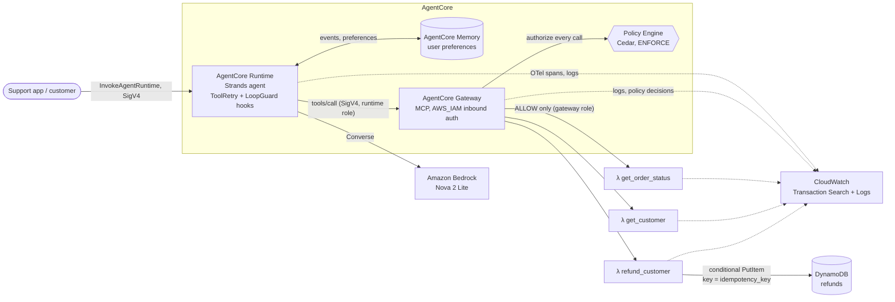

# Customer Support Agent on Amazon Bedrock AgentCore

A customer support agent for an online electronics store, built with Strands Agents and Amazon
Bedrock AgentCore. It answers order questions, looks up customers and issues refunds through business
tools exposed by AgentCore Gateway over MCP. A Cedar policy on the gateway, not the prompt, decides
which refunds are allowed.

## Deployment

Everything runs in AWS account `536035781966`, region `us-east-1`: the agent on AgentCore Runtime,
AgentCore Memory, the gateway with its three Lambda tools, the Cedar policy engine, and
CloudWatch observability. The model is Amazon Nova 2 Lite (`us.amazon.nova-2-lite-v1:0`) on Amazon
Bedrock.

## Architecture



A refund request flows like this: the model calls `refund_customer` through the gateway, the policy
engine evaluates the call, and only an ALLOW reaches the Lambda. The Lambda writes the refund with a
conditional put keyed on the idempotency key, so a retried call returns the existing refund.

## Requirements and evidence

| Requirement | Where | Evidence |
|---|---|---|
| Runtime + Strands, picks the right tool | [`SupportAgent/app/support_agent`](SupportAgent/app/support_agent) | [agent scenarios](evidence/scenarios) |
| Gateway with MCP tools (3 business tools) | [`agentcore.json`](SupportAgent/agentcore/agentcore.json), [`backend/`](backend) | [agent and gateway scenarios](evidence/scenarios) |
| Memory across two sessions | [`memory/session.py`](SupportAgent/app/support_agent/memory/session.py), [`request_identity.py`](SupportAgent/app/support_agent/request_identity.py) | [agent scenarios](evidence/scenarios) |
| Identity / IAM, no long-lived credentials | [docs/security.md](docs/security.md) | [least-privilege check](evidence/security/least-privilege.txt) |
| Refund ≤ $1,000 allowed, > $1,000 denied | [`policies/`](SupportAgent/policies) | [scenarios](evidence/scenarios), [traces](evidence/observability) |
| Prompt injection cannot bypass authorization | [docs/security.md](docs/security.md) | [agent scenarios](evidence/scenarios), [trace](evidence/observability) |
| Retry does not create a duplicate refund | [`refunds.py`](backend/src/support_backend/refunds.py) | [operation-123](evidence/reliability/idempotency-operation-123.txt) |
| Retries with exponential backoff, loop protection | [`reliability/`](SupportAgent/app/support_agent/reliability) | Unit tests, [traces](evidence/observability) |
| Observability, failures traceable | [docs/observability.md](docs/observability.md) | [traces](evidence/observability) |

The full list of evidence files is in [evidence/README.md](evidence/README.md).

## Repository layout

```
backend/              Business tools: Lambda handlers, CDK stacks, tool schemas, unit tests
SupportAgent/         AgentCore project (agentcore CLI)
  agentcore/          agentcore.json: runtime, gateway, targets, policy engine
  app/support_agent/  The Strands agent (runtime code)
  policies/           Cedar policies
  iam/                Extra IAM policy for the runtime role
  tests/              Agent unit tests
scripts/              Scenario runners (agent, gateway), trace viewer, least-privilege and account checks
docs/                 Security and observability write-ups
evidence/             Outputs from runs against the deployed system
```

## Deploy

Prerequisites: an AWS account in `us-east-1`, Node.js 20+, the AgentCore CLI
(`npm install -g @aws/agentcore`), the AWS CDK CLI, `uv`, and AWS credentials from `aws login` or IAM
Identity Center. No access keys are needed. Enable CloudWatch Transaction Search once per account
(CloudWatch → Application Signals → Transaction Search) so spans are searchable.

1. Bootstrap CDK and deploy the business tools:
   ```bash
   cd backend
   cdk bootstrap
   cdk deploy SupportAgentBackend --outputs-file cdk-outputs.json
   ```
2. Deploy the agent runtime, memory, gateway, targets and policy engine:
   ```bash
   cd SupportAgent
   agentcore deploy
   ```
   Some values are specific to the account: the Lambda ARNs in `agentcore.json`, the gateway ARN and
   account in `policies/*.cedar`, and the account in `iam/runtime-bedrock-model-access.json`. In a
   new account, update them and deploy twice: first without the policy engine, then add it with the
   new gateway's ARN.
3. Deploy gateway logging, tracing and the saved Logs Insights queries:
   ```bash
   cd backend
   cdk deploy SupportAgentObservability
   ```
4. Verify:
   ```bash
   uv run scripts/run_scenarios.py         # gateway-level scenarios
   uv run scripts/run_agent_scenarios.py   # end-to-end through the deployed agent
   uv run scripts/check_least_privilege.py
   ```

Talk to the deployed agent; the actor header names the end user, which scopes long-term memory:

```bash
agentcore invoke -H "X-Amzn-Bedrock-AgentCore-Runtime-Custom-Actor-Id: alice" "Why is my order 123 delayed?"
```

## Test

```bash
cd backend && uv run pytest
cd SupportAgent && uv run --project app/support_agent pytest tests
```

## Run the agent locally

`agentcore dev` runs the same agent on your machine against the deployed gateway and policy.
It can also use the Anthropic API instead of Bedrock; add these lines to the git-ignored
`SupportAgent/agentcore/.env.local`:

```
MODEL_PROVIDER=anthropic
ANTHROPIC_API_KEY=<your key>
```

## Tear down

```bash
cd SupportAgent && agentcore remove all && agentcore deploy
cd backend && cdk destroy --all
```

## Design notes

- **Money is integer cents.** Cedar has no decimal type, so the refund limit is
  `context.input.amount_cents <= 100000`.
- **The refund limit lives only in the Cedar policy.** The backend checks that a refund does not exceed
  the order total, but it does not duplicate the $1,000 rule. The system prompt does not mention the
  rule either.
- **Errors come in two kinds.** Bad input and business-rule errors are returned to the model as data,
  and are never retried. Failures such as timeouts and HTTP 5xx fail the Lambda invocation, so the
  gateway reports `isError: true` and the agent retries them with backoff.
- **Model choice.** Nova 2 Lite is an Amazon model, so it needs no Marketplace subscription. To use
  another model, set `MODEL_ID` and allow that model in `iam/runtime-bedrock-model-access.json`.
- **Known limitation:** refunds are not totalled per order, so several refunds under the limit can
  together exceed the order total.
